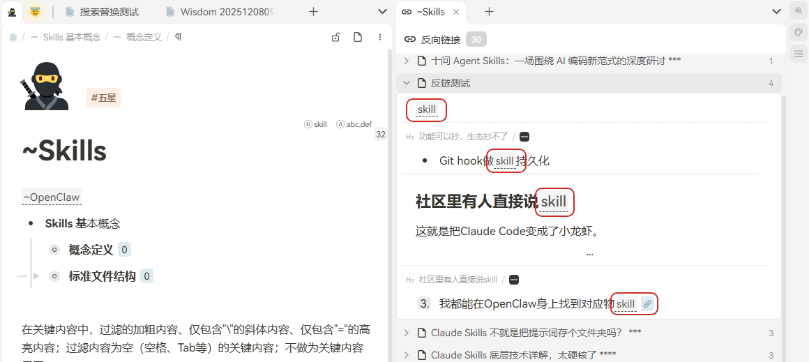
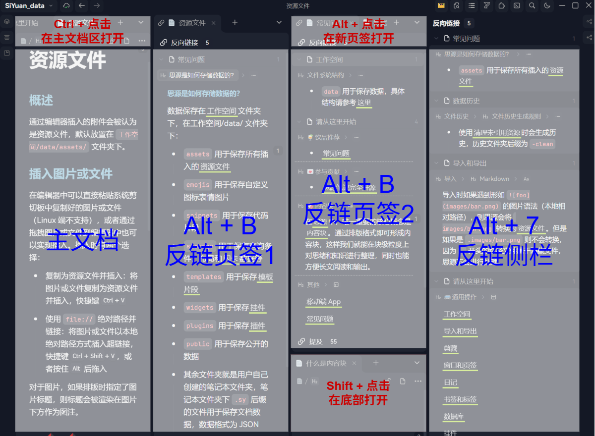
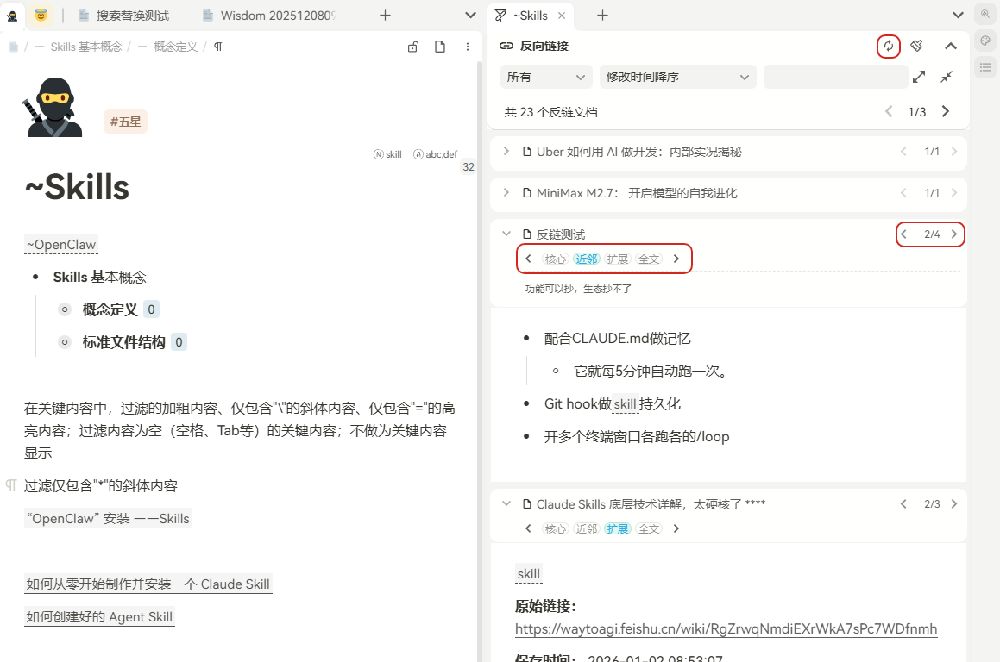
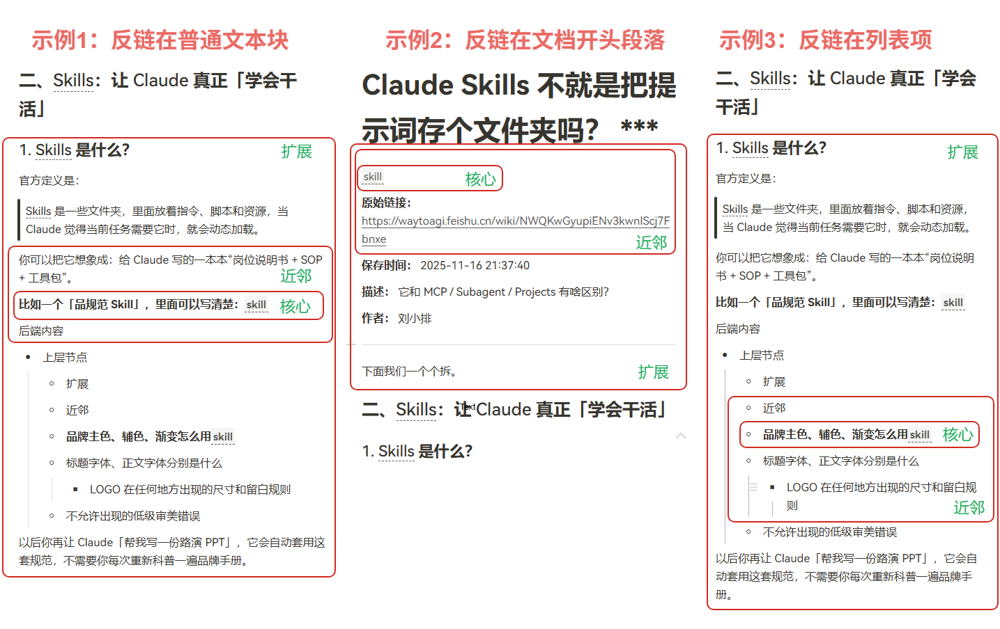

# Deeply Drawn to the Concept of Bidirectional Links, But Why Do I Always Avoid the Backlink Panel?

## Prologue: Why do I always bypass the backlink panel/tab?

SiYuan Note is a representative of bidirectional linking apps, and backlinks are a very important feature. Many people come to bidirectional linking with a bit of expectation: hoping to reduce the pressure of archiving when taking notes in the future. You don't have to figure out the structure right from the start; just jot it down, wait for the clues to slowly grow, and then use backlinks to re-string related content together. This idea is fascinating, and it was exactly what drew me in at first.

But after using it for over half a year, I discovered something slightly awkward: although I know backlinks are important, when it comes to actually organizing topic notes, I often find myself circling back to the document tree and sub-documents. The backlink panel is right there on the side, but it always feels like a "good in theory" feature that I intentionally or unintentionally ignore. Why is that?

I thought carefully about it and found two main issues. The first is unclear context.

Because of different use cases and habits, the position of a backlink in a document is not fixed. It could appear at the beginning of a document, hang under a subtitle, or hide inside a list item. For me, I don't just want to know "there is a backlink here"; I also want to judge the scope of this backlink in the original text. Did it just mention it in passing, or did it introduce a whole paragraph of discussion? Does the list item it's in have parent-child relationships? Should I extract this part to my topic note? How much should I extract so that I don't miss anything without destroying the original text?

However, the current context display provided by the backlink panel is relatively fixed. If there are multiple backlink locations in one document, the content between these locations is cut off and blocked, as if a content black hole has appeared. I can see the local parts, but I can't see how the clues connect before and after. As a result, I always feel uneasy when organizing, constantly worrying that after moving a small piece of content, the original text will be scattered, or the truly important context is still hidden in the undisplayed parts.

The second reason is that the interaction design is not concise enough.

When I try to organize topic notes, I find myself constantly having to jump out of the backlink panel. For example, clicking on a backlink document opens a new window in different locations. Using Ctrl, Shift, and Alt combinations all have different effects. Furthermore, backlinks have both a tab and a panel, and their functions also differ—the official documentation doesn't explain this in detail. (I even wrote a post specifically for this: *[Research: What's the difference between the backlink panels that appear with Alt+7 and Alt+B? - Liandi](https://ld246.com/article/1753280518610)*).

In theory, flexibility is a good thing. But in actual use, pop-ups, tabs, docking panels, plus the different effects of a bunch of key combinations—too much flexibility becomes a mental burden to remember. Whenever I want to focus on organizing a specific topic, my attention is forced to split: Where should I click next? Which entry is more suitable? Will it jump to a new interface again? I was supposed to be following the clues forward, but it feels like I'm constantly interrupted by forks in the road.

## Backlink Manager: Uninterrupting Your Note-Organizing Flow

How can we solve the above problems and make the backlink panel/tab easier to use? I had some ideas, and I've initially implemented a modded plugin—Backlink Manager (tentative name).

First, I designed a flexible yet unified solution for displaying backlink context, supporting progressive switching between 4 context states (Core - Neighbor - Extended - Full Text).

* **"Core"**: Shows only the exact line, item, or block where the backlink hits, letting me first know exactly where the hit occurred.
* **"Neighbor"**: Supplements a bit of context before and after the core, helping me understand what precedes and follows the sentence.
* **"Extended"**: Takes a step outward based on the structure. If the backlink is under a heading, it expands that heading section; if it's in a list item, it brings out siblings and necessary hierarchical relationships.
* **"Full Text"**: The ultimate fallback. When I'm still unsure, or if the clue inherently relates to the entire document, I can directly view the complete original text, eliminating the fear of unseen content black holes.

This covers different scenarios and user habits. What used to be a one-size-fits-all display method has now become a progressive expansion based on the scenario. I can finally decide with peace of mind: Is this content worth extracting? How relevant is it to the topic I'm currently organizing?

The ensuing benefit is that in most cases, I don't need to jump out of the backlink panel/tab. I can directly edit, cut, and paste back and forth with the topic note in the main window, keeping my flow uninterrupted to the greatest extent.

Additionally, I've made some optimizations to the interactions.

Previously, my strongest feeling in the backlink panel was "too many forks in the road." What does clicking the document title do? What about the button next to it? What roles do the tab and the panel play respectively? Which actions change with the current document, and which don't? How do I keep the current view... Each of these features makes sense individually, but when stacked together, they turn what should be an intuitive tool into an interface that requires frequent rule recall.

Therefore, I set a rather restrained principle for Backlink Manager's interactions: Keep the truly high-frequency, intuitive actions, and cut out the flexible but mentally burdensome forks.

**First**, aggregate backlinks by source document and only display/process one backlink block at a time. This change is small, but it makes it easier to focus your attention. Organizing notes isn't about processing a dozen clues simultaneously; it's about looking at them one by one, making judgments one by one. Focusing your eyes on the same source document, plus the ability to switch the context state to "Full Text", gives a much better sense of the whole picture.

**Second**, reassign the function of clicking on the title. Originally, clicking the title duplicated the expand/collapse button next to it. I simply changed it to two more intuitive, high-frequency actions: Left-click opens in the main window; Right-click opens in the right-side tab. This way, I barely need to remember those complex key combinations anymore.

**Third**, consolidate the backlink tab and the backlink panel into one unified interface. Their core difference is essentially just "whether to refresh the backlink content as the current document changes." I didn't want to maintain two entrances that look similar but act differently. Instead, I unified them into one interface that maintains stable backlink content by default (matching the current backlink tab interaction logic); I added a "Refresh" button in the top right corner, so you actively click to refresh when a change is needed (matching the current backlink panel interaction logic). This unified interface carries the functions of both scenarios while reducing cognitive load.

## Expectation: Returning Backlink Management to Its Original Intent

The reason bidirectional linking notes are so attractive is that they promise an easier way to organize: I don't have to meticulously archive everything from the start. I can record first, connect first, let the content grow, and then slowly sort it out later.

But if the backlink ultimately acts just as a powerful display area, rather than a workspace that truly enters the organizing process, then this promise is only half fulfilled. You see the connections, but you haven't truly converted them into actionable materials. You know the clues exist, but you still need to constantly jump around, guess, and fill in the context, eventually retreating to the document tree and hierarchy for a sense of security.

To me, a truly useful tool isn't necessarily one that piles more information in front of you, but one that keeps you feeling in control. When you are processing a backlink clue, you clearly know which layer you are looking at; you know that if it's not enough, you can continue expanding outward; you know how the interface will change after a click. You don't have to organize the tool itself while organizing your content.

Let backlink management return to its original intent, and let the freedom initially promised by bidirectional notes truly land in daily use.

## Acknowledgements

The initial version of this plugin is modified based on the [Misuzu2027/syplugin-backlink-panel](https://github.com/Misuzu2027/syplugin-backlink-panel) project. It is also an excellent backlink management enhancement plugin. Thanks to the original author!
